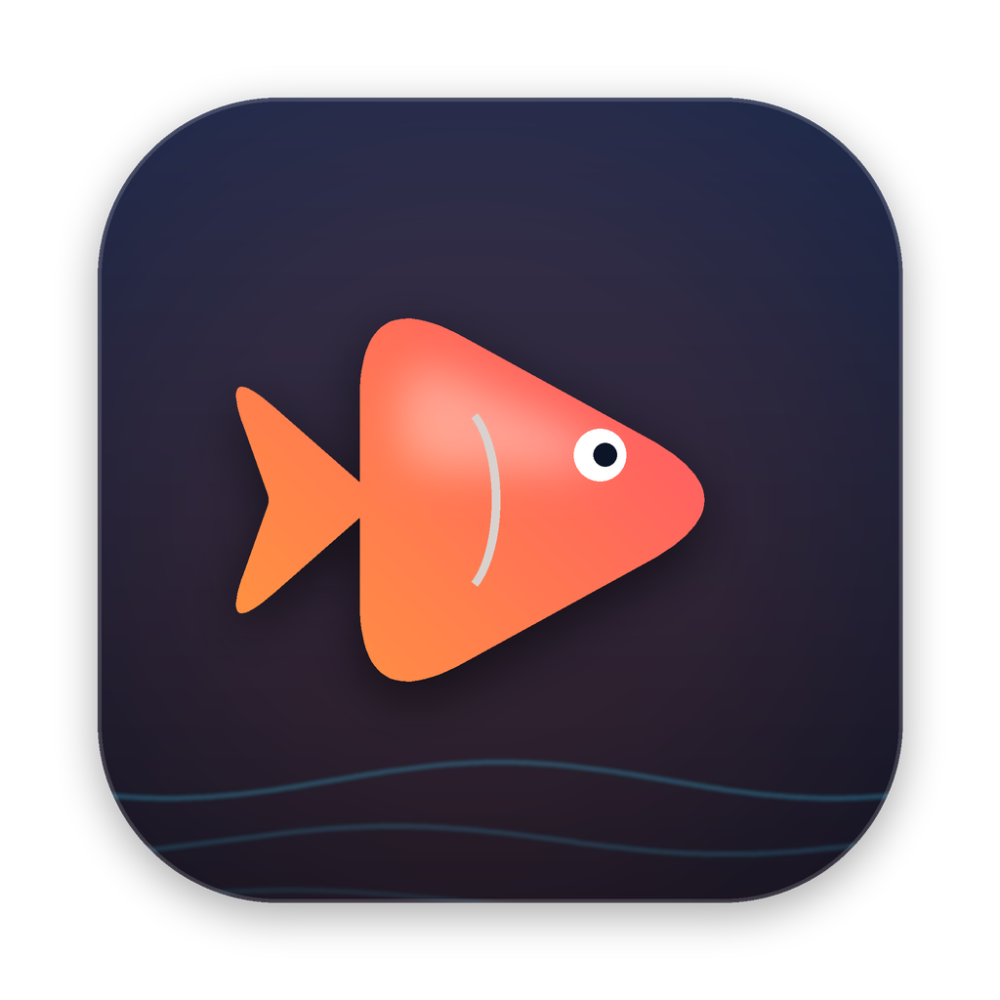
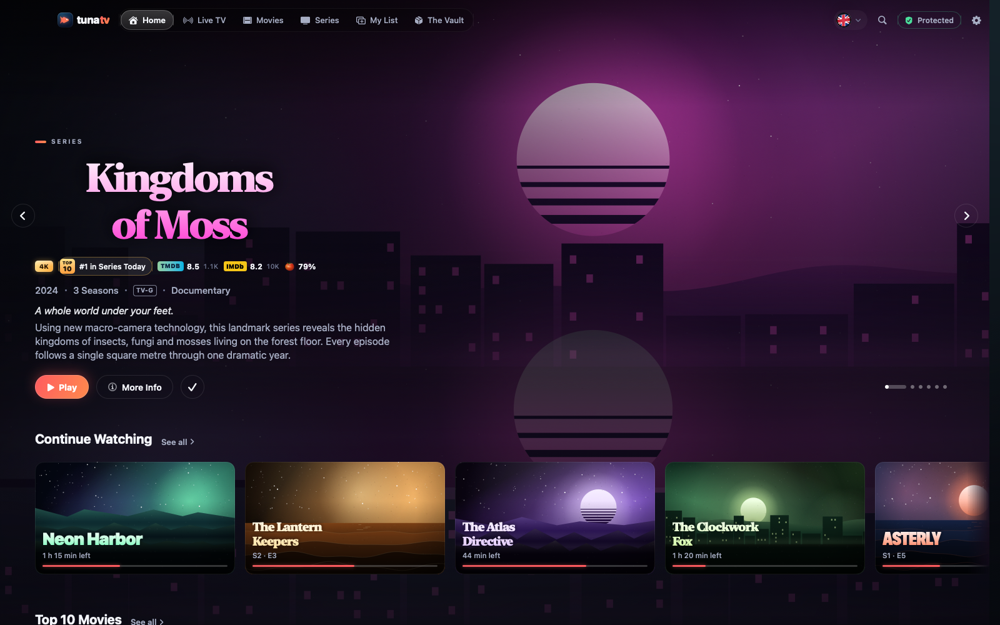
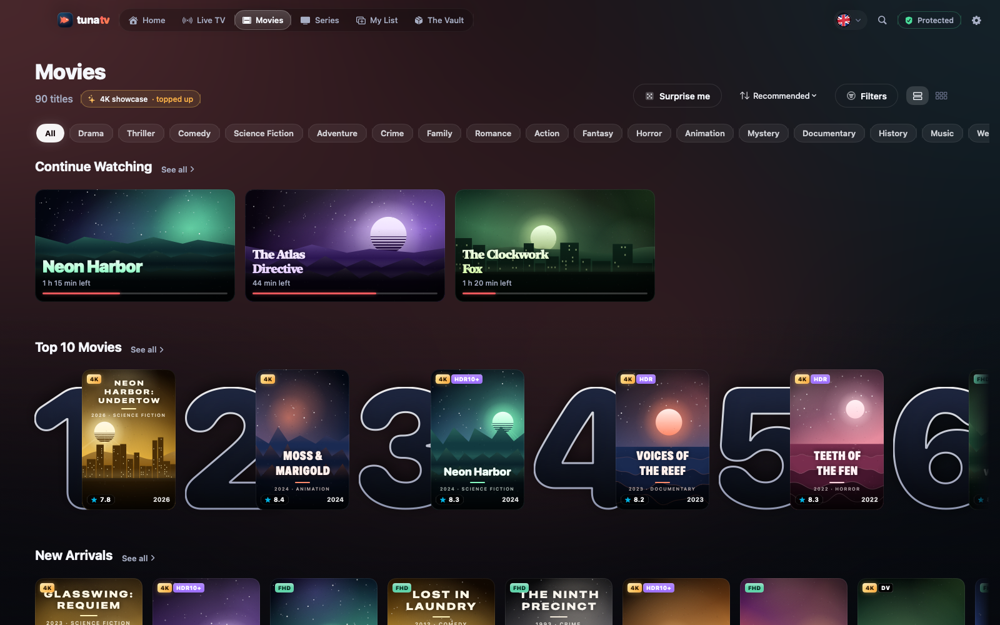
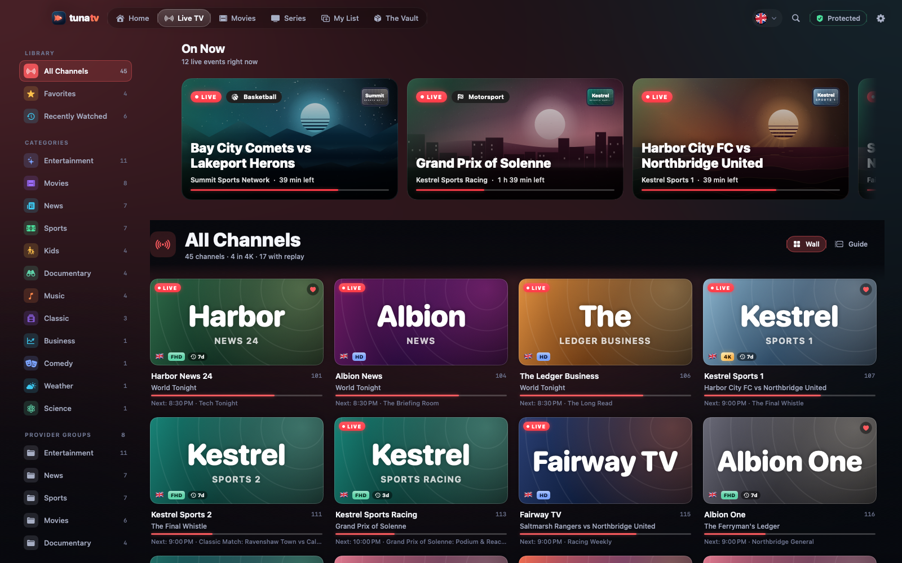
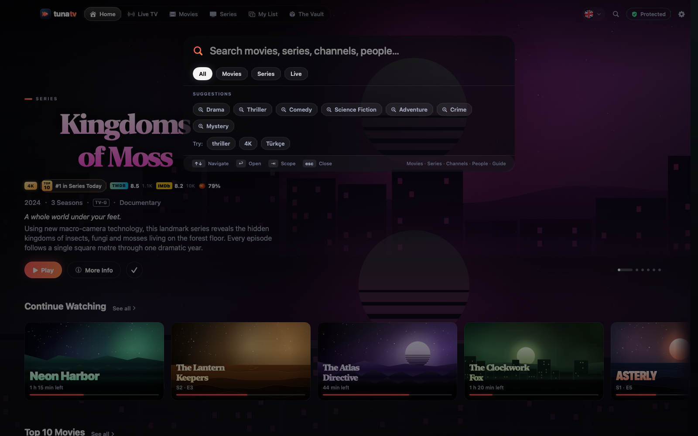
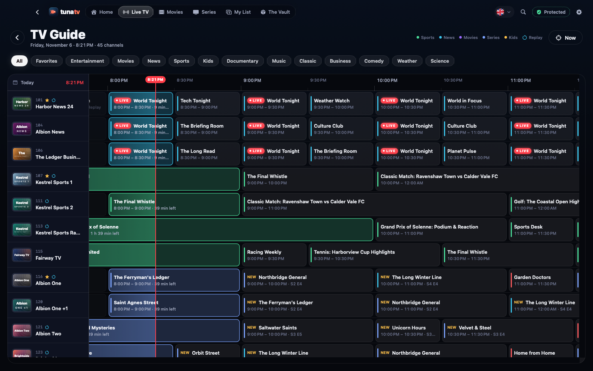

<p align="center">
  
</p>

<h1 align="center">Tuna TV</h1>

<p align="center">
  <b>Arguably the best IPTV app for macOS.</b><br>
  Free forever. No ads, no accounts, no tracking. A weekend project that turned out a little too good.
</p>

<p align="center">
  <a href="https://github.com/dsugurtuna/tuna-tv/releases/latest"><b>⬇︎ Download for macOS</b></a> ·
  <a href="#getting-started">Getting started</a> ·
  <a href="#how-tuna-tv-protects-your-account">Account safety</a> ·
  <a href="#build-from-source">Build from source</a>
</p>

<p align="center">
  <a href="https://github.com/dsugurtuna/tuna-tv/actions/workflows/build.yml"></a>
  
  
  
  
</p>

---

Your IPTV subscription probably gives you 50,000 entries of chaos: `EN| The Matrix 4K`, `|TR| The Matrix (1999) Dublaj`, `THE MATRIX HDCAM`, forty copies of the same channel and a category called `VIP ◉ 4K-NF ▎`.

**Tuna TV turns that into a streaming service.** Duplicates merge into one title. The best version plays by default. Everything is enriched with posters, cast, ratings and trailers. And the junk goes into one tidy box you can open when you want it.

<p align="center">
  
</p>

## Why Tuna TV

| | |
|---|---|
| 🛡️ **It won't get you banned** | Many IPTV apps hammer your provider with parallel requests and retry storms until your account gets flagged. Tuna TV sends **one request at a time**, opens **one stream at a time**, caches everything, and pauses itself if your provider pushes back. A live **Provider Shield** shows exactly what it is doing. |
| ✨ **A 4K showcase** | Home, Movies and Series show only the best versions by default (4K / HDR), deduplicated and ranked. Prefer Full HD and up, or everything? One switch. |
| 📦 **The Vault** | Blu-ray rips, HD versions, legacy SD, cam copies and other-language duplicates aren't deleted. They live together in **one box**, sorted into shelves with clear badges. |
| 🌍 **Your worlds** | English by default. Add Türkiye, Deutschland, España or 100+ other countries and languages, and their originals and dubs join your showcase with their own rails. |
| 🎬 **Tons of metadata** | Title logos, backdrops, cast with photos, directors, writers, studios, countries with flags, keywords, collections, trailers, certifications. Ratings from TMDB, plus IMDb, Rotten Tomatoes and Metacritic when you add a free key. |
| 📺 **Live TV, rethought** | A channel wall with what's on now and next, live sports and news events up top, a smooth timeline guide with catch-up, channel number entry, last-channel recall and a zapping strip. Duplicate feeds (FHD/HD/SD/backup) merge into one channel with automatic quality choice. |
| 🍿 **Series done right** | Seasons and episodes with stills, per-episode progress, Up Next with a countdown, and resume anywhere. |
| 🔎 **⌘K search** | Instant, typo-tolerant search across movies, series, channels, people and what's on air. |
| ⚡ **Native and efficient** | SwiftUI on Apple Silicon. Playback by [AetherEngine](https://github.com/superuser404notfound/AetherEngine) (FFmpeg + VideoToolbox): MKV, TS, HLS, HEVC, AV1, HDR10, HDR10+, Dolby Vision, Atmos passthrough, Picture in Picture. |
| 📊 **Insights** | See your library decoded: duplicates merged, quality mix, languages, countries, genres, decades. |

<p align="center">
  
  
</p>
<p align="center">
  
  
</p>

## Getting started

1. **Download** the latest `TunaTV-macOS.dmg` from [Releases](https://github.com/dsugurtuna/tuna-tv/releases/latest) and drag **Tuna TV** to Applications.
2. Tuna TV is free and open source, but it isn't notarized by Apple. On first launch, open **System Settings → Privacy & Security** and click **Open Anyway**, or run this once:

   ```bash
   xattr -dr com.apple.quarantine "/Applications/Tuna TV.app"
   ```

3. **Add your provider.** Use your **Xtream Codes** login (server, username, password), paste the full link your provider gave you, or use an **M3U playlist** URL. Tuna TV checks the login with a single request.
4. **Pick your worlds** (languages and countries) and your **showcase quality**.
5. *(Optional, recommended)* Paste a free [TMDB API key](https://www.themoviedb.org/settings/api) for posters, cast photos, trailers and ratings. Add an [OMDb key](https://www.omdbapi.com/apikey.aspx) for IMDb, Rotten Tomatoes and Metacritic scores.

No provider yet? Click **Try the demo** to explore the whole app with a fully invented demo library.

> Tuna TV is a player. It provides **no content** and isn't affiliated with any provider. Use it with a subscription you have the right to watch.

## How Tuna TV protects your account

The original version of this app got an account banned, so Tuna TV 2 was rebuilt around one rule: **be the gentlest client your provider has ever seen.**

| Rule | What it means |
|---|---|
| One request in flight | Every call to your provider goes through a per-provider governor: one at a time, at least 1.5 s apart (configurable), with jitter. |
| Rare, sequential sync | The catalog syncs at most once a day, section by section, never in parallel. On launch you see the cached library instantly, with no requests. |
| No per-channel guide flood | The TV guide downloads once a day in one request. It is never fetched per channel or per row. |
| One stream, ever | A stream gate makes sure only one connection is open. Zapping is debounced, and the old stream is fully closed before the next one opens. |
| No retry storms | A failed stream or request is never retried automatically. You get a clear message and a Retry button with a cooldown. A circuit breaker pauses everything for 5 min, 30 min, then 2 h if your provider says "slow down" (401/403/429/509/5xx). |
| No hidden connections | No seek-preview decoders, no background prefetch, no probes on your streams. Panel-hosted images load one at a time and are cached forever. |
| Consistent identity | The same User-Agent for API calls, images and streams (VLC-compatible by default; presets available). |

## Build from source

```bash
brew install xcodegen
```

```bash
git clone https://github.com/dsugurtuna/tuna-tv.git && cd tuna-tv && xcodegen generate
```

```bash
open TunaTV.xcodeproj
```

Requirements: Xcode 26 or later, macOS 15 or later, Apple Silicon. The core library (`Packages/TunaCore`) builds and tests anywhere Swift runs, including Linux:

```bash
swift test --package-path Packages/TunaCore
```

Every push runs CI on GitHub Actions: Linux and macOS tests, a fast type-check, a Release build, a launch self-test, UI snapshots rendered from the demo library, and a DMG.

## Architecture

```
App/                   SwiftUI app (macOS 15+)
  Core/                AppModel (state), Router, Keychain
  Design/              Theme, components, image pipeline, generative artwork
  Features/            Home, Browse, Detail, Live, Guide, Vault, Search, Onboarding, Settings, Insights
  Player/              AetherEngine wrapper, player UI, PiP, Now Playing
Packages/TunaCore/     Foundation-only core, unit-tested on Linux and macOS
  Networking/          RequestGovernor, StreamGate, HostLimiter (provider safety)
  Providers/           Xtream Codes, M3U, XMLTV
  Curation/            Name parser, tag grammar, dedupe, showcase vs Vault, worlds
  Metadata/            TMDB, TVMaze, OMDb, iptv-org
  Library/             Index, search, ranking, rails, guide, demo content
```

More detail in [docs/ARCHITECTURE.md](docs/ARCHITECTURE.md).

## Credits

Tuna TV stands on the shoulders of great open-source work. It studies ideas from
[IPTVMac](https://github.com/Goelir/IPTVMac), [IPTVnator](https://github.com/4gray/iptvnator), [Hypnotix](https://github.com/linuxmint/hypnotix), [Lume](https://github.com/bilipp/Lume) and [iptv-org](https://github.com/iptv-org), and plays video with [AetherEngine](https://github.com/superuser404notfound/AetherEngine). Metadata comes from [TMDB](https://www.themoviedb.org) (this product uses the TMDB API but is not endorsed or certified by TMDB), [TVMaze](https://www.tvmaze.com), [OMDb](https://www.omdbapi.com) and [iptv-org](https://github.com/iptv-org/database). See [THIRD_PARTY_NOTICES.md](THIRD_PARTY_NOTICES.md).

## License

[GPL-3.0](LICENSE). Free as in beer and as in speech. Built as a weekend project by [@dsugurtuna](https://github.com/dsugurtuna).
